# Instagram Comments — analysis and ProductDefinition (2026-11-17)

Reanalyzed and implemented 2026-11-17 against the current catalog mapping and project-root handler registry. The scope is **Instagram → Comments → Instagram Comments**, using the 233 mapped row IDs only. The canonical ProductDefinition now exists at `products/instagram-comments.json` and is mirrored in the Service Builder comments seed for visualization. Static DGP structural and semantic validation pass; Service Builder UI validation was not run. The source registry and mapping file remain unchanged.

## Recommendation summary

Treat all **233 mapped rows** as the candidate scope for the catalog service **Instagram Comments**. The set includes standard/random and customer-written comments, comment packages, a poll-vote variant and a reply-to-comment variant, plus target and audience variations. Different `payload.type` values create different order flows, so these rows are not interchangeable; however, they remain in this mapped-scope analysis rather than being dropped.

Normalize the mapped set into customer-facing choices by behavior: random/default comments, customer-written comments, comment packages, comment replies, and poll-vote comments, while also evaluating target variants (post, Reel, Live, Channel) and audience/language/style variants. This is a grouping proposal for the mapped Instagram Comments family, not a claim that every flow must share one form.

The product uses row **868** as the `Default → Standard` tag default, with rows **895 → 871** as its fallback chain. Row 868 supports quantities 10–50,000 without drip-feed; 895 and 871 support drip-feed and have different upper bounds. Treat these as fallback candidates only when the order quantity and selected drip-feed setting are supported.

## Scope and source evidence

- Catalog entry: `instagram-comments-comments`, **Instagram Comments**, under Instagram → Comments; status is `definition_created`, with `products/instagram-comments.json`.
- `products/instagram-likes.json` informed the tag/default-service, service-choice option, and fallback structure only. Its handler IDs and service facts were not reused.
- Handler source is the project-root `handler services.json`, a 5,734-row bare JSON array. It has no top-level site, tenant, or project identity. Every mapped row has `payload.panel_key: jap`, `dgp_handler_id: 1`, and a JAP-prefixed `external_id`; those fields do not identify the intended site/tenant. All 233 mapped rows currently show `payload.catalog_sync.last_seen_at: 2026-11-16T12:00:16+00:00`.
- Mapping source is `catalog-handler-service-ids.json`, key `instagram-comments-comments`: 233 IDs, 233 unique, all resolved against the current registry; no stale IDs or duplicates.
- Every mapped row currently has `is_enabled: true`, `is_locked: false`, and `state_reason: null`. This describes the snapshot, not live health or storefront availability.
- Mapped `payload.type` counts: `Default` 154; `Custom Comments` 61; `Package` 7; `Custom Comments Package` 9; `Poll` 1; `Comment Replies` 1. The 215 `Default` and `Custom Comments` rows are the main count-based/text-list modes; the other 18 mapped rows remain part of the analysis as package, poll-vote, and reply variants with different input shapes.
- Mapped source capability counts: drip-feed 36/233; cancel 15/233; refill 0/233; contract 0/233. All mapped rows report refill disabled, including names containing refill/non-drop wording. Do not expose refill based on a name. For an eventual drip-feed control, follow the user-approved rule from Instagram Likes: show runs/interval only where the selected service advertises drip-feed support.
- The contract distinction is important: root registry `id`, `dgp_handler_id`, and provider `external_id` are separate. The mapping contains root row IDs. In product work, keep those identifiers distinct and scoped to this registry.
- The current local `@elqora/dgp-spec` package (installed 1.6.0) supplies the generic HandlerService contract. It does not define JAP `payload.type` as a customer input schema. The `.ai/JAP-SERVICE-TYPES.md` guide supplies the host-specific order-field rules used below.
- Builder capability snapshot: `.ai/service-builder-capabilities.json`, dated 2026-11-13 with no Builder version specified. It registers `text/default`, `textarea/default`, `chips/default`, `number/default`, and single-choice `select/default` relevant here. `chips/default` is the appropriate control for newline-separated comment entries; its registered UI includes a `separators` property. Per the user's explicit direction, all three chips fields set Form Palette `textareaMode: true` in field defaults, with `separators: ["Enter"]`, matching current Form Palette keyboard-shortcut semantics. The local Form Palette adapter forwards field defaults to the input component; its current authoring UI metadata does not expose `textareaMode`, so the setting is present in the definition but not editable through that inspector control. The chip list supplies the entry count for quantity calculation, while the JAP request still receives `comments` as a newline-separated list. Policies in that snapshot are context only and must not be edited or generated.

## Handler-ID reconciliation

### Every mapped ID, grouped by the source category

| Raw handler category | Rows | Mapped root row IDs |
| --- | ---: | --- |
| Instagram Comments | 88 | 853, 855, 856, 857, 858, 859, 860, 861, 862, 863, 864, 865, 866, 867, 868, 869, 870, 871, 872, 873, 874, 875, 876, 877, 878, 879, 880, 881, 882, 883, 884, 885, 886, 887, 888, 889, 890, 891, 892, 893, 894, 895, 896, 897, 899, 900, 902, 903, 904, 905, 906, 907, 908, 909, 910, 911, 912, 913, 914, 915, 916, 917, 918, 919, 920, 921, 922, 923, 924, 925, 926, 927, 928, 929, 930, 931, 932, 933, 934, 935, 936, 937, 938, 939, 940, 941, 942, 943 |
| Instagram Comments [VERIFIED/TOP ACCOUNTS] | 54 | 944, 945, 946, 947, 948, 949, 950, 951, 952, 953, 954, 955, 956, 957, 958, 959, 960, 961, 962, 963, 964, 965, 966, 967, 968, 969, 970, 971, 972, 973, 974, 975, 976, 977, 978, 979, 980, 981, 982, 983, 984, 985, 986, 987, 988, 989, 990, 991, 992, 993, 994, 995, 996, 997 |
| Instagram Reel | 26 | 803, 804, 805, 806, 807, 808, 809, 810, 811, 812, 813, 814, 815, 816, 817, 818, 819, 820, 821, 822, 823, 824, 825, 826, 827, 828 |
| Instagram TOP Services [EXCLUSIVE] | 19 | 33, 34, 35, 36, 37, 38, 39, 40, 41, 42, 56, 57, 63, 64, 87, 88, 89, 100, 101 |
| Instagram EGYPT - VERIFIED Services 🇪🇬 | 8 | 1454, 1455, 1456, 1457, 1458, 1459, 1460, 1461 |
| Instagram Western Europe + USA Services 🇪🇺 🇬🇧 🇺🇸 | 7 | 1325, 1326, 1327, 1337, 1338, 1359, 1371 |
| Instagram BRAZIL Services 🇧🇷 | 6 | 1373, 1374, 1376, 1377, 1420, 1421 |
| Instagram TURKEY - VERIFIED Services 🇹🇷 | 6 | 1445, 1446, 1447, 1448, 1449, 1450 |
| Instagram Live Video | 4 | 1044, 1045, 1046, 1048 |
| Instagram SOUTH KOREA Services 🇰🇷 | 4 | 1425, 1426, 1427, 1428 |
| Instagram Super Services | 4 | 1039, 1040, 1041, 1042 |
| Instagram Auto Comments / Impressions / Saves / Reach | 2 | 1504, 1505 |
| Instagram ITALY Services 🇮🇹 | 2 | 1435, 1436 |
| Instagram Channel Members | 1 | 1156 |
| Instagram NIGERIA Services 🇳🇬 | 1 | 1431 |
| Instagram TURKEY Services 🇹🇷 | 1 | 1444 |
| **Total** | **233** | **All rows resolve; none stale or duplicated.** |

### Mapped IDs by actual order type (current snapshot)

This cross-check partitions the mapped candidates by order type without treating different types as interchangeable or removing them from the service analysis. IDs come from the root `id` values in this scoped registry.

- `Default` (154 candidate rows): 33–42, 57, 64, 87–89, 101, 803–815, 855–859, 864–865, 867–872, 874–877, 879–880, 882–889, 891–895, 897, 900, 902, 905–907, 911–923, 941–942, 944–988, 990, 993–994, 996–997, 1044–1046, 1048, 1156, 1325–1327, 1337, 1359, 1371, 1373–1374, 1376–1377, 1421, 1425–1428, 1431, 1435.
- `Custom Comments` (61 candidate rows): 56, 63, 100, 816–828, 853, 860–863, 866, 873, 878, 881, 890, 896, 899, 903–904, 908–910, 924–935, 937–940, 989, 991–992, 995, 1039–1042, 1338, 1420, 1436, 1444.
- Additional mapped variants: `Package` 1445–1450,1504; `Custom Comments Package` 1454–1461,1505; `Poll` 936; `Comment Replies` 943. Keep these in the candidate set, with separate package, poll-vote, or reply order flows as required by their actual type. Rows 1504–1505 have monthly Auto Comments wording but package types; that mismatch needs resolution rather than an inferred subscription flow.

The registry's enable/lock flags are only source-state evidence. No handler has been live-tested here, so none is claimed to work or be available in a storefront.

## Normalize and group the Instagram Comments variants

The provider category labels organize records; they are not customer tags. Normalize on customer-visible service behavior and compatible order inputs, then use a select option only where the variation is real and the mapping is known. Do not turn the raw categories into a deep tree or advertise provider claims as verified facts.

| Customer-facing viewpoint | Current evidence | Proposed treatment |
| --- | --- | --- |
| Random/default one-time comments | 154 mapped `Default` rows; examples include generic random comments, emoji/sentiment, relevant/hype-style, and audience or regional labels. | One fulfillment mode. Audience, language, or style may become explicit choices if the team intends to promise them and can bind each choice to compatible rows. Treat “high quality,” “verified,” “power,” or similar terms as provider wording, not independently verified quality. |
| Customer-written comments | 61 mapped `Custom Comments` rows, including 33 in raw `Instagram Comments`. | Separate fulfillment mode because the order sends customer text. JAP guide: required `link` and `comments`; one comment per line (`\n` or `\r\n`); no separate JAP `quantity`. Use `chips/default` to parse the lines into entries and derive quantity from the chip count. |
| Target: post versus Reel | 26 mapped `Instagram Reel` rows (13 `Default`, 13 `Custom Comments`). Other rows occur in the generic `Instagram Comments` and audience/category groups. | Decide whether one Instagram Comments product accepts both post and Reel URLs, or whether Reel comments need a separate service. Source category and handler name indicate Reel targeting, but the exact accepted URL validation is not described in the local contract. Never fall back across targets unless both accept the submitted target. |
| Target: Live/Channel | Four rows in `Instagram Live Video`; one `Instagram Channel Comments` row in `Instagram Channel Members`. | Keep these mapped comment variants in scope. Decide whether they are target options in this product or need distinct conditional inputs/UX; confirm target URL compatibility before sharing handlers or fallbacks. |
| Audience, geography, language, account labels | Rows include USA/UK, Brazil, Korea, Arabic, Italy, other regional/language labels, gender labels, and “verified/top/power” wording across categories. | These are candidate variants, not separate products by default. Show only deliberate choices backed by specific rows. A fallback must keep the same audience and language promise. Do not assert the named account characteristics were independently verified. |
| Fixed package-like counts | 74 `Default` rows have registry `min=max=1000` even though names commonly enumerate fixed comments (often 5–400). | This is a real mismatch between the JAP `Default` quantity shape and the registry row bounds/name. Do not use as ordinary variable-quantity handlers until the adapter/provider meaning of 1000 is clarified. Preserve the snapshot as-is in analysis. |
| Other mapped JAP types | One `Poll` row (936), one `Comment Replies` row (943), seven `Package`, nine `Custom Comments Package`. | Retain these as mapped Instagram Comments variants. Poll comments are votes and need `answer_number`; replies need the comment owner's `username` plus reply text; packages use package-specific quantity semantics and may represent comment bundles. Their different inputs may need separate conditional modes. |
| Refill, retention, speed, delivery wording | Several names claim refill/non-drop or delivery speed; mapped refill capability is false for all rows. | Keep as source notes only. Do not promise refill/retention or delivery guarantees from names. Drip-feed can be offered only on rows with `capabilities.dripfeed.enabled: true`. |

### `Default` type: top-level variants and sub-tags

The 154 mapped `Default` rows are grouped below by their registry category into mutually exclusive top-level variants. The counts sum to 154. The sub-tags are evidence-based dimensions seen in names; they can overlap and are not additional top-level groups. Country names remain source-label details and are not individual customer-facing variants.

| Top-level variant | Rows | Sub-tags evidenced in mapped names |
| --- | ---: | --- |
| Standard | 53 | General/random; style or tone (emoji, positive/negative, hype); relevance/context; audience labels; language/region; delivery details. |
| Exclusive | 16 | Power/Explore and 10K+ follower wording; audience labels; language/region; delivery details. |
| Reels | 13 | Audience labels; language/region; HQ wording; relevance/context. |
| Verified accounts | 50 | Power/Explore wording; audience labels; language/region. Preserve the raw category wording; it is not independent verification. |
| Countries/regions | 17 | One geography/region grouping. Do not create individual country variants from country names in handler categories or names. |
| Live video | 4 | Random; male/female audience labels; instant delivery wording. |
| Channel comments | 1 | Positive tone. |
| **Total** | **154** | |

```mermaid
flowchart TD
    A[Instagram Comments — Default: 154]

    A --> B[Standard — 53]
    A --> C[Exclusive — 16]
    A --> D[Reels — 13]
    A --> E[Verified accounts — 50]
    A --> F[Countries/regions — 17]
    A --> G[Live video — 4]
    A --> H[Channel comments — 1]

    B --> B1[General/random]
    B --> B2[Style/tone]
    B --> B3[Relevance/context]
    B --> B4[Audience]
    B --> B5[Language/region]
    B --> B6[Delivery details]

    C --> C1[Power/Explore wording]
    C --> C2[Audience]
    C --> C3[Language/region]
    C --> C4[Delivery details]

    D --> D1[Audience]
    D --> D2[Language/region]
    D --> D3[HQ wording]
    D --> D4[Relevance/context]

    E --> E1[Power/Explore wording]
    E --> E2[Audience]
    E --> E3[Language/region]

    F --> F1[Geography/region grouping]
    F1 -.-> F2[No individual country variants]

    G --> G1[Random or audience-labeled]
    G --> G2[Instant delivery wording]

    H --> H1[Positive tone]

    A -. eligible handlers only .-> I[Drip-feed button]
    I --> I1[Runs]
    I --> I2[Interval]
```



Sub-tag descriptions reflect name/category wording, not guaranteed service outcomes. They do not imply that every row under a top-level variant supports every sub-tag. Drip-feed is a capability-controlled Builder option, not a comment type: 36 of the 154 `Default` rows enable it. Show `Runs` and `Interval` under the Drip-feed button only for eligible selected handlers. Keep speed/start-time and refill/no-drop claims as handler details unless separately substantiated and intentionally exposed.

The mapped rows also have a bounds conflict to resolve before choosing handlers: 74 `Default` rows have registry `min=max=1000`, while their names commonly mention smaller comment quantities. The conflict does not change this category-based grouping.

### Full working tag tree (2026-11-17)

This tree covers all 233 mapped rows by payload type and current category-based variants. Top-level counts sum to 233. Within `Custom Comments`, the Standard and Reel subgroups have deeper name-based breakdowns; the other 15 rows are grouped by their source categories. Country/region labels remain grouped and are not individual customer-facing variants.

```text
Instagram Comments (233)
├── Default (154)
│   ├── Standard (53)
│   │   └── Style/tone, relevance, audience, region/language, delivery details
│   ├── Exclusive (16)
│   │   └── Power/Explore wording, audience, region/language, delivery details
│   ├── Reels (13)
│   │   └── Audience, region/language, HQ, relevance wording
│   ├── Verified accounts (50)
│   │   └── Power/Explore wording, audience, region/language
│   ├── Countries/regions (17)
│   │   └── Geography/region grouping; no individual country tags
│   ├── Live video (4)
│   │   └── Random or audience-labeled; instant delivery wording
│   └── Channel comments (1)
│       └── Positive wording
├── Custom Comments (61)
│   ├── Standard (33)
│   │   ├── General custom comments (8)
│   │   ├── Region/language-only qualifier (18)
│   │   ├── Gender qualifier (4; includes two rows also naming a region)
│   │   ├── Relevance wording (1)
│   │   └── Premium/high-end wording (2)
│   ├── Reels (13)
│   │   ├── Gender qualifier only (2)
│   │   ├── Region/language qualifier only (10)
│   │   ├── Both qualifiers (1)
│   │   └── “HQ” wording applies to 10; overlaps these groups
│   ├── Verified/top-account category (4)
│   ├── Super Services category (4)
│   ├── Exclusive category (3)
│   └── Region/category group (4)
├── Package (7)
│   ├── Fixed-count packages (6; listed counts 1–6)
│   └── Auto Comments, monthly wording (1; behavior unresolved)
├── Custom Comments Package (9)
│   ├── Fixed-count packages (8; listed counts 1, 2, 3, 4, 5, 10, 15, 20)
│   └── Auto Comments, monthly wording (1; behavior unresolved)
├── Poll (1)
└── Comment Replies (1)
```

The Standard and Reel subgroups under `Custom Comments` each sum to their parent count. The `HQ` wording is an overlapping qualifier, not an extra subgroup. The two Auto Comments rows are one each under `Package` and `Custom Comments Package`; their names say “monthly unlimited,” but their payload types do not establish recurring behavior. Poll requires `link`, `quantity`, and `answer_number`. Comment Replies requires `link`, `username`, and newline-separated `comments`; derive its quantity from the chip count (`value.length`).

### Exact input shapes and Builder implications

- **`Default`:** JAP requires `link` and `quantity`. Optional `runs` and `interval` apply only when that selected handler supports drip-feed and the customer enables it. In TygerBooster, `Drip feed` is a Builder toggle; `drip_feed` is not a JAP request field. The linked runs/interval inputs should be included only when the toggle is on, and every candidate handler bound to the enabled option must support drip-feed.
- **`Custom Comments`:** JAP requires `link` and newline-separated `comments`; there is no separate API quantity. The Builder derives quantity from the number of lines. Use the registered `chips/default` control for the newline-separated comments list. Its parsed entries provide the derived quantity; the adapter must serialize them as a newline-separated `comments` value. Do not add a separate JAP `quantity` field for this type merely because the registry displays min/max values.
- **`Package` / `Custom Comments Package`:** keep mapped rows in the candidate set as package variants. The guide specifies fixed internal package quantity one; custom-comments packages also require `link` and newline-separated `comments`; collect those entries with `chips/default` and derive the comment-list count from the chip array. Names and package contents should determine whether they are discrete comment packages or bundled engagements.
- **`Poll` / `Comment Replies`:** keep mapped rows in the candidate set as conditional order modes. Poll requires `answer_number`; replies require `username` and newline-separated `comments`; collect reply lines with `chips/default` and derive count from the chip array. Confirm whether the product should expose these as comment-vote/reply modes or whether catalog taxonomy needs a separate service item; do not drop the mapped rows silently.
- **Rows 1504–1505:** names say monthly unlimited-post Auto Comments, while actual mapped types are `Package` and `Custom Comments Package`. Keep them mapped as package candidates; the guide does not establish recurring subscription behavior for these types, so confirm semantics before promising monthly automation.
- Quantity bounds in the registry are `payload.min`/`payload.max`. They are not the Builder Quantity Template’s validation bounds. For `Default`, use actual service bounds where those bounds are coherent; do not copy the template’s 10–10,000,000 limits. For `Custom Comments`, count of supplied lines determines quantity, but the 74 fixed-1000 `Default` anomalies remain unresolved.

## Product tag defaults and fallback chains

- The root tag uses service **895**. The root binding is unique among direct filter defaults; 895 also appears as a service choice in the Standard category because it is one of the mapped Standard handlers.
- The `Default → Standard` tag default is **868**; its generic random fallback chain is **895 → 871**. Row 868 supports quantities 10–50,000 without drip-feed; 895 and 871 are random `Default` rows with drip-feed enabled, and row 871 caps at 50,000. Bounds and selected-service capabilities still govern whether a fallback can serve a particular order.
- Other evidenced chains: verified-account default **993 → 994**; Live Video default **1044 → 1048** (same visible name, bounds, and order shape); Standard custom-comments default **860 → 862** (same custom-text order shape and overlapping bounds).
- No fallback was invented for a unique audience, language/region, target, fixed package count, poll, or reply choice. Those remain without an evidenced compatible alternate in this snapshot. Fallbacks indicate candidates, not proven service health.

## Product fields and service-choice mapping

- The definition now follows the discussed hierarchy: root → payload-type tags (`Default`, `Custom Comments`, `Package`, `Custom Comments Package`) → their mapped variants, with evidence-backed qualifier sub-tags under the analyzed Default and Custom Comments branches. Poll and Comment Replies remain single mapped branches under the root. The Builder visualization has 52 filters, 45 fields, and an `order_for_tags` entry for every filter; every filter has a default `service_id`. Service-choice fields are placed only on leaf tags, so a selected path shows one service dropdown rather than one from every ancestor.
- The tag defaults are: root **895**; Default—Standard **868**, Exclusive **64**, Reels **803**, Verified **993**, Countries/regions **1337**, Live video **1044**, Channel **1156**; Custom Comments—Standard **860**, Reels **816**, Verified **995**, Super Services **1039**, Exclusive **56**, Countries/regions **1338**; Package fixed **1445**, Auto Comments **1504**; Custom Comments Package fixed **1454**, Auto Comments **1505**; Poll **936**; Comment Replies **943**. These are root `id` values from the current registry, not `dgp_handler_id` or provider `external_id` values.
- All 233 mapped IDs are represented across leaf-tag service choices and tag defaults. Internal hierarchy tags use their default service directly; a service-choice selector is attached only to a leaf tag, avoiding duplicate selectors inherited from ancestors. The 74 `Default` rows whose registry bounds are `min=max=1000` remain listed as category options, flagged in ProductDefinition metadata; they are not chosen as tag defaults. Their name/bounds conflict is unresolved.
- Order fields follow each payload type: `link`; `quantity` and drip-feed controls for `Default`; a separate `quantity` field and `answer_number` for Poll; newline chips with `value_by: "length"` for Custom Comments, Custom Comments Package, and replies; and `username` for replies. The separate chips fields preserve the independent order shapes.
- The Drip feed button and its `Runs`/`Interval` includes are on Default paths only. Visibility requires the selected service context to support drip-feed. All mapped non-Default rows have drip-feed disabled.
- All payload-specific customer input fields bind to `t:root`. Their `visibility_expression` checks the selected handler's `meta.provider_payload_type` in `preview.service_context`, so root service 895 (`Default`) exposes `quantity` and its eligible Drip feed control. Chip fields require their matching `Custom Comments`, `Custom Comments Package`, or `Comment Replies` type; poll quantity/answer require `Poll`; and username requires `Comment Replies`. Runs and intervals remain included by the Drip feed button and require drip-feed capability. Service-choice selectors remain leaf-tag-bound and keep the tag hierarchy visibility.
- The two Auto Comments rows (1504,1505) are represented under separate tags according to their payload types. Their labels omit a monthly promise; recurring behavior remains unresolved.

## Remaining source limits

1. **Fixed-1000 Default rows:** 74 Default rows have `min=max=1000`, while their names often enumerate smaller quantities. They are present as service-choice options but not tag defaults; resolve adapter/provider behavior before relying on these rows for smaller quantities.
2. **Auto Comments:** rows 1504–1505 say monthly unlimited posts, while payload types are `Package` and `Custom Comments Package`. The local guide does not establish recurring behavior for these types; the product does not promise monthly fulfillment.
3. **Registry scope:** the source identifies `payload.panel_key: jap` but not the target tenant/site. The product and Service Builder seed are for local visualization; do not treat this registry as a confirmed live-site source.

## Status and validation

The approved product scope is implemented in `products/instagram-comments.json` and mirrored by `instagramCommentsDefinition` in the Service Builder seed. The comments workspace contains all 233 mapped handler records and is the active standalone Builder workspace. Catalog status is `definition_created` (not `validated`). After the requested root binding of all payload-specific inputs, `@elqora/dgp-validation` 1.2.0 reports `quantity_source_conflict` for mutually exclusive provider-type quantity sources bound at root; its static check does not apply the authored `visibility_expression` conditions. An Ordering preview for root service 895 showed `link`, `quantity`, and `drip_feed` and a `Default` service context. Builder UI validation and live handler health checks were not run.

